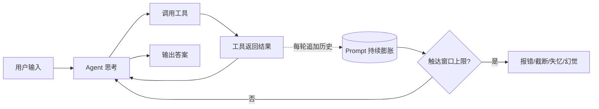
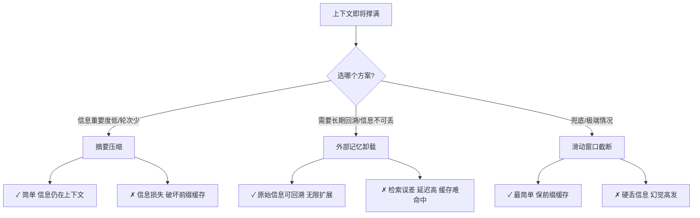
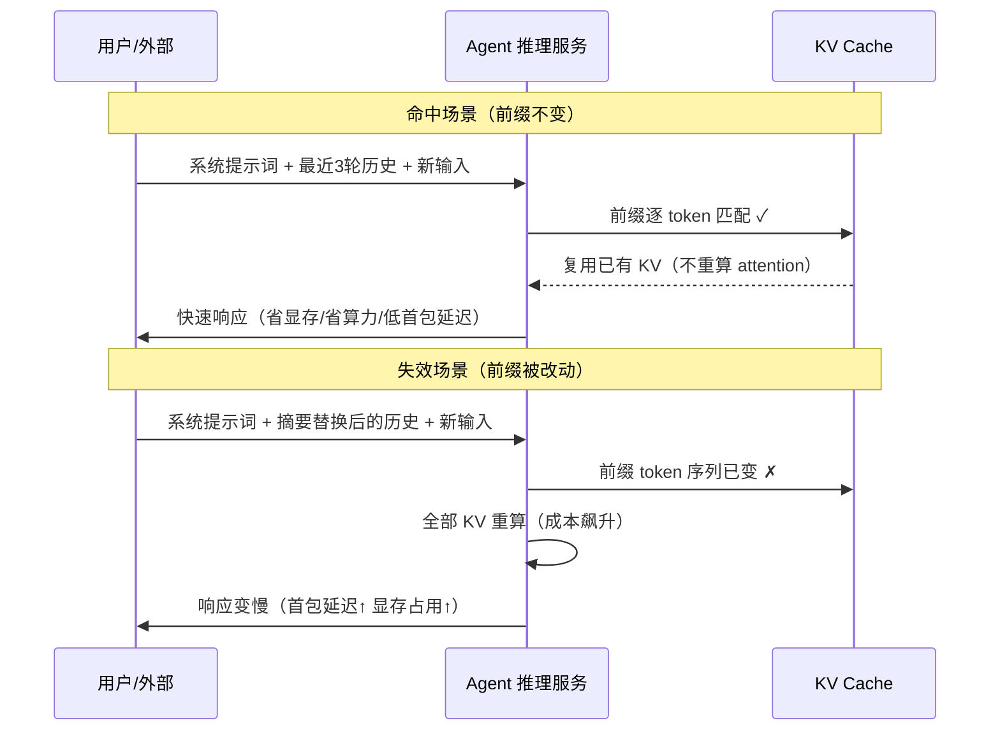
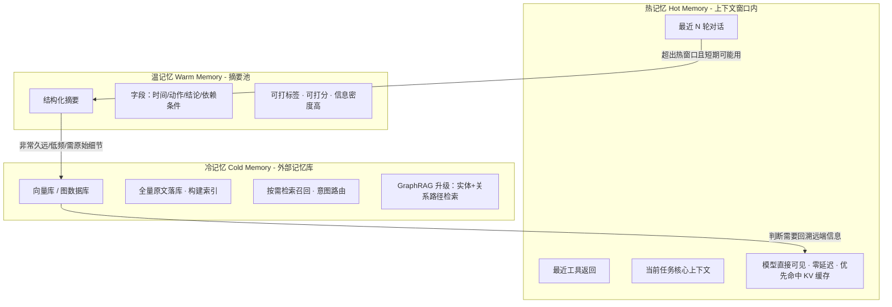
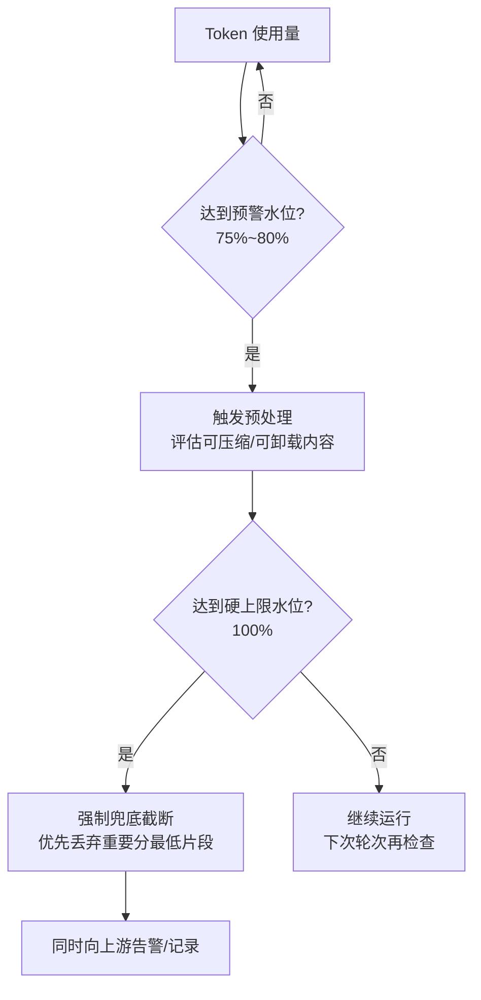
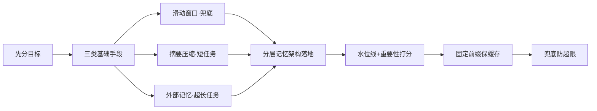

> **已处理 · 2026-10-20**：原文保留在下方，不代表每个断言已被证实。原始作者、平台链接和发布日期未提供；岗位/公司与“必考”等说法未独立验证。
>
> 整理到：[正式章节 §7.13.3、§7.13.7、§7.13.10](../../chapters/07-memory-context-engineering.md)。
> 纠错、采纳范围与验证依据：[本轮处理记录](../../verification/2026-10-20-inbox-rerank-context.md)。
> 网页内容已准备同步；GBrain 仅在正式章节审核并提交到 main 后更新，本文件不进入索引。

---

## 原始材料（逐字保留）

# 字节二面 · Agent 上下文预算面试题全解

> **岗位**：Agent 应用开发岗
> **原题**：Agent 上下文快要撑满了，该怎么办？
> **核心考察点**：上下文窗口、KV Cache、前缀缓存、摘要压缩、外部记忆、工程取舍、边界 case、方案选型
> **难度定位**：Agent 开发高频重灾区面试题，二面必考

---

## 一、题目背景

大模型有固定上下文窗口上限（128k / 200k / 1M tokens）。Agent 是多轮循环执行：**思考 → 调用工具 → 返回结果 → 继续思考**，对话持续膨胀。

随着轮次变多，历史对话、工具返回内容、中间推理日志不断塞入 prompt，token 持续上涨，最终触达上下文预算上限：

- **报错**：`context length exceeded`
- **降级**：被迫截断，丢失关键信息，Agent 失忆、幻觉、任务跑偏
- **性能劣化**：KV Cache 暴涨，显存占用变高，推理 latency 上升

**面试官本质想问的不是"你知道摘要、RAG 吗"，而是**：你能不能权衡不同方案对**缓存、召回精度、业务正确性、成本**的影响，知道**什么时候选什么方案**，以及底层 **KV Cache、前缀缓存**的代价。

---

## 二、两大基础方案：压缩方案 vs 卸载方案

| 维度 | 压缩方案（Summarize 摘要） | 卸载方案（外部记忆 / 记忆库） |
| --- | --- | --- |
| **核心逻辑** | 保留在上下文窗口内；对远端历史对话做摘要、提炼要点，用短摘要替换一大段原始对话，减少 token | 原始文本**移出上下文窗口**，存入外部存储（向量库、文件、KV 库、图数据库）；需要时通过检索把相关片段召回，放回 prompt |
| **优势** | 实现简单；所有信息仍在上下文，模型直接读到，无需额外检索；很多框架原生支持 | 原始信息完整可回溯；不会永久丢失细节；只要检索做得好，长期任务可以无限跑 |
| **劣势** | 摘要有信息损失；摘要本身越积越多，长期任务依然会慢慢撑满；**破坏前缀缓存** | 引入检索误差；多了 RAG 链路，增加延迟；需要维护记忆索引、路由、相关性判断；召回错了 Agent 直接出错；**天然破坏前缀缓存** |
| **适用场景** | 短期任务、对话逻辑简单、不需要回溯原始细节、交互轮次不多 | 超长任务、需要历史溯源、专业调研 Agent、多会话长期记忆、GraphRAG |
| **典型实现** | Claude Code auto compact、自定义 summary 节点、滑动窗口摘要、重要性加权摘要 | 向量数据库、Mem0、外部 Memory、MCP 记忆服务、GraphRAG |

> ### 兜底方案：滑动窗口截断
> 简单扔掉最早的历史，只保留最近 N 轮。
> - ✅ **优点**：最简单、零额外开销、**不破坏前缀缓存**（只要固定保留尾部）
> - ❌ **致命缺点**：硬丢信息，很早但关键的前置条件直接消失，幻觉高发
> - **定位**：只做兜底，不做主方案

---

## 三、核心分水岭：前缀缓存（Prefix Cache / KV Cache 复用）【面试追问重点】

### 3.1 前缀缓存原理

大模型推理时，KV Cache 保存每一步 token 对应的 K、V 向量。

**前缀缓存命中规则：输入 prompt 的前面一大段（前缀）必须逐 token 完全一模一样，才能复用已经算好的 KV Cache。**

命中之后：不需要重复计算这部分 token 的 attention，**大幅省显存、省算力、降低首包耗时**。

> **举例**：固定系统提示词 + 最近 3 轮对话每次都相同，只追加新的用户输入 / 工具返回 → 前缀完全一致，持续命中缓存。

### 3.2 三种方案对前缀缓存的影响（面试核心区分点）

| 方案 | 对前缀缓存的影响 | 说明 |
| --- | --- | --- |
| **滑动窗口截断** | ✅ **可以稳定命中** | 只删最前面、后面内容顺序不变，窗口内序列不变，前缀不变；代价是信息丢失 |
| **摘要压缩方案** | ❌ **缓存失效** | 把前面一大段替换成摘要文本，前缀 token 序列直接变了，每次压缩后下一轮推理全部 KV 重算，成本飙升 |
| **外部记忆卸载** | ❌ **基本很难命中** | 原始历史移出上下文，每轮召回结果动态变化，prompt 前缀动态变化，缓存命中率极低 |

> ⚠️ **很多人面试踩坑点**：只说摘要好用，不提缓存代价。

**优化思路（摘要方案）**：
- 不要频繁压缩，**批量压缩**；
- 把系统 prompt、固定模板放在最前面**不动**，只压缩远端可变历史，尽量保住最前面固定前缀缓存。

**高并发 Agent 设计（高频追问答案）**：
> 分层策略 + 固定前缀隔离：
> 1. 把永远不变的系统 prompt、角色定义、工具描述放在最头部，永远不动，这一段稳定做前缀缓存；
> 2. 可变历史区做分层：近期热历史留在上下文（尽量不动，维持缓存）；远期冷历史要么延迟摘要，要么丢到外部记忆；
> 3. 不要每一轮都做压缩/检索，**设置阈值触发**（如 token 达到上限 80% 水位线才触发）。

---

## 四、进阶：分层记忆架构（工程落地标准做法，二面加分项）

工业界 Agent 一般不会单用摘要或单用向量检索，而是**分层**：

**各层要点**：

1. **热记忆（Hot Memory）**：留在上下文窗口内
   - 最近 N 轮对话、最近工具返回、当前任务核心上下文，模型直接可见
   - 读取零延迟，优先命中 KV 缓存
   - 策略：滑动窗口 + 重要性打分；不重要的弱信息优先标记为待压缩/卸载，重要信息优先保留

2. **温记忆（Warm Memory）**：摘要池
   - 超出热窗口、但短期可能用到的历史，压缩成**结构化摘要**
   - ⚠️ 不要纯自然语言，用结构化：**时间、动作、结论、依赖条件**
   - 结构化摘要比自由文本摘要**信息密度更高、幻觉更少**；可以给摘要打标签、打分

3. **冷记忆（Cold Memory）**：外部记忆库（向量库/图数据库）
   - 非常久远、低频访问、需要原始细节的内容，全量原文落库，构建索引
   - 只有 Agent 判断需要回溯远端信息时才触发检索召回
   - 搭配**意图路由**：先判断当前问题是否依赖远期历史，不需要就不走 RAG 检索，减少开销

> **GraphRAG 定位**：冷记忆升级。当历史之间有强关联、依赖关系（多步骤规划、因果链），向量相似度召回不够，用**图结构**保存实体、关系，做**路径检索**。

---

## 五、触发策略 & 水位控制（工程落地细节）

**不是写死满了才处理**，一般用**双水位**：

- **预警水位**（总 token 达到上限 75%~80%）：触发预处理，开始评估哪些内容可以压缩/卸载，**提前处理，避免突刺**；
- **硬上限水位**（达到窗口上限）：强制兜底截断，优先丢弃重要分最低的片段。

**重要性打分维度（决定先删谁、先压谁）**：

| 维度 | 说明 |
| --- | --- |
| 时间衰减 | 越久远权重越低 |
| 目标相关性 | 是否和当前 Agent 目标、工具调用依赖强相关 |
| 价值类型 | 事实结论（高价值）vs 中间调试日志（低价值） |
| 用户约束 | 用户明确强调不能丢的信息 |
| 结构化程度 | 工具返回的原始结构化数据（如 API JSON），轻易不要摘要 |

---

## 六、各个方案的缺陷与坑点（面试官深挖环节）

### 摘要方案坑
1. 摘要本身会累积误差，多次摘要叠加 → 信息失真、因果丢失
2. 模型会基于摘要做推理，摘要错了，后续全错
3. 压缩时机不好控制：压早了浪费算力，压晚了 OOM
4. **破坏前缀缓存，拉高推理成本**

### 外部记忆 RAG 卸载坑
1. **检索偏差**：相似度匹配 ≠ 逻辑相关；语义相近但无关的内容召回进来，引入幻觉
2. **召回缺失**：关键信息没有被召回，Agent 以为没有这段历史
3. **链路复杂**：索引构建、分片、去重、更新、embedding 成本
4. **缓存失效**：多轮动态召回导致 prompt 抖动，缓存失效
5. **运维成本**：额外依赖向量库

### 滑动窗口坑
简单粗暴，适合 Demo，业务 Agent 慎用，容易丢失前置约束条件。

---

## 七、答题总分结构（面试口述版，直接背）

> **面试官**：Agent 上下文快要撑满了，该怎么办？

**答**：
1. **先区分目标**：我们是优先保证推理性能、高 QPS，还是优先保证长任务信息不丢失？基于这个选择方案。
2. 一共有三类基础手段：**滑动窗口截断、历史摘要压缩、外部记忆卸载**。
3. 滑动窗口最简单，可以保留前缀缓存，但会丢信息，一般只做兜底。
4. 摘要压缩是把远端历史浓缩，留在上下文，实现简单，但会损失信息，并且修改 prompt 序列、破坏 KV 前缀缓存，适合轮次不多的任务。
5. 外部记忆是把原始历史移出上下文存入向量库/记忆库，需要时召回，原始信息可回溯，适合超长 Agent 任务，但会引入检索误差，同时前缀缓存很难命中，延迟更高。
6. **工程上落地一般用分层记忆**：热记忆放在上下文窗口，优先保住 KV 缓存；温记忆存结构化摘要；冷记忆落外部记忆库。
7. 同时**设置水位线**，达到阈值才触发压缩或者检索，并且给历史片段做重要性打分，优先丢弃不重要内容。
8. 另外设计上尽量把固定系统 prompt、工具描述放在最前面不动，**保住这一段的前缀缓存**，平衡效果和推理成本。
9. 最后还要做**兜底策略**，防止极端情况 token 超限报错。

---

## 八、高频连环追问合集（附带答案）

### Q1：前缀缓存和 KV Cache 是一回事吗？
**不是。** KV Cache 是每一步所有 token 的 K/V 向量缓存；前缀缓存是 KV Cache 的一种**复用优化**：当开头前缀完全一致时，复用这部分 KV，不用重复计算。KV Cache 每轮都生成，前缀缓存是可命中的优化能力。

### Q2：结构化摘要和普通自然语言摘要哪个好？
**结构化更好**。固定字段：时间、动作、输入、输出、关键结论、待办、约束；模型更容易读取，摘要漂移更少，还方便后续过滤、打分。

### Q3：Agent 怎么自己判断要不要去外部记忆检索？
两种方式：1）让 Agent 自己输出工具调用（如 `need_memory_search`）；2）前置轻量分类器判断当前 query 是否依赖远期历史；**避免每次都检索**。

### Q4：MCP 和这个外部记忆是什么关系？
MCP 是**协议标准**，用来统一 Agent 和外部工具/记忆资源的访问；记忆库可以包装成 MCP 服务，Agent 通过 MCP 接口读写冷记忆，属于外部记忆的一种实现形态。

### Q5：如果是多 Agent，多个 Agent 共享同一份历史记忆，怎么处理上下文预算？
共享底层记忆库（冷记忆统一）；每个 Agent 自己维护独立的热上下文窗口；各自按需召回。注意**记忆隔离、读写权限**，避免不同 Agent 任务互相污染。

---

## 九、可选延伸加分：新方向（拉高上限）

- **上下文压缩新方案**：LLM-aware compression、token 级剪枝
- **稀疏 KV Cache、动态 KV 淘汰**：不在 prompt 文本层面删，在 KV 向量层面做淘汰——保留文本但丢弃不重要 KV，兼顾缓存和上下文
- **上下文窗口扩展**：原生大模型长上下文（1M+），本质是硬件/模型侧解法，成本高，不能无限依赖

---

## 附：快速记忆卡片

| 关键结论 | 一句话 |
| --- | --- |
| 窗口上限触达的三种后果 | 报错 / 截断失忆 / KV 暴涨性能劣化 |
| 三类基础手段 | 滑动窗口截断、摘要压缩、外部记忆卸载 |
| 谁保前缀缓存 | 滑动窗口 ✅；摘要 ❌；外部记忆 ❌ |
| 高并发最优设计 | 固定系统前缀不动 + 分层记忆 + 阈值触发 |
| 分层记忆三层 | 热（上下文内）/ 温（结构化摘要）/ 冷（外部库） |
| 双水位 | 75%~80% 预警预处理；100% 强制兜底截断 |
| 重要性打分维度 | 时间衰减 / 目标相关 / 事实 vs 日志 / 用户约束 / 结构化数据 |
